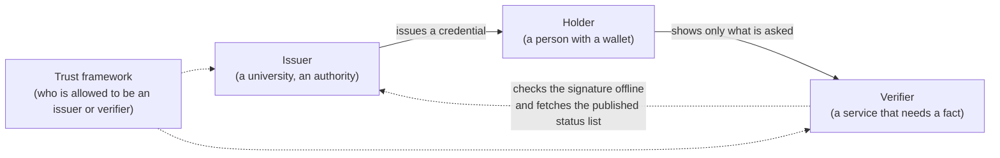
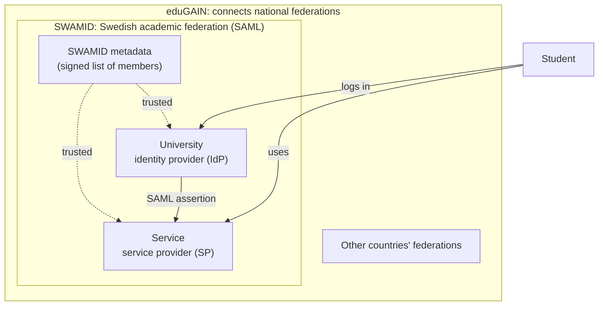
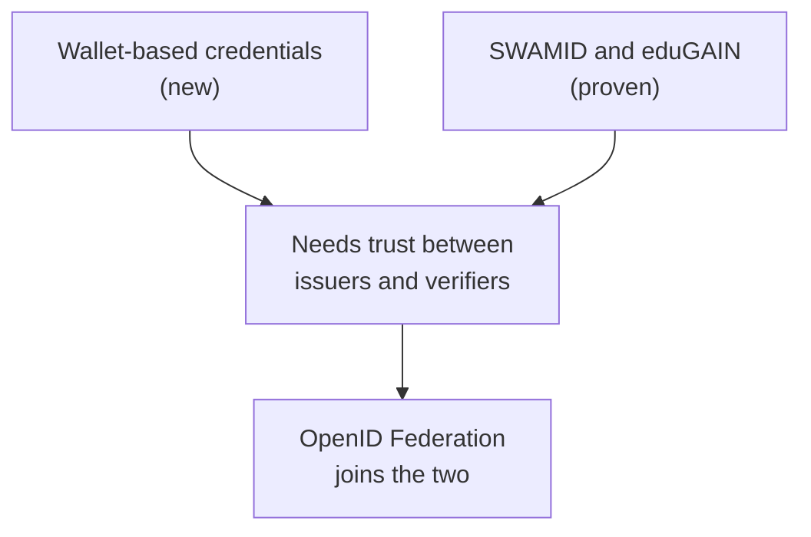
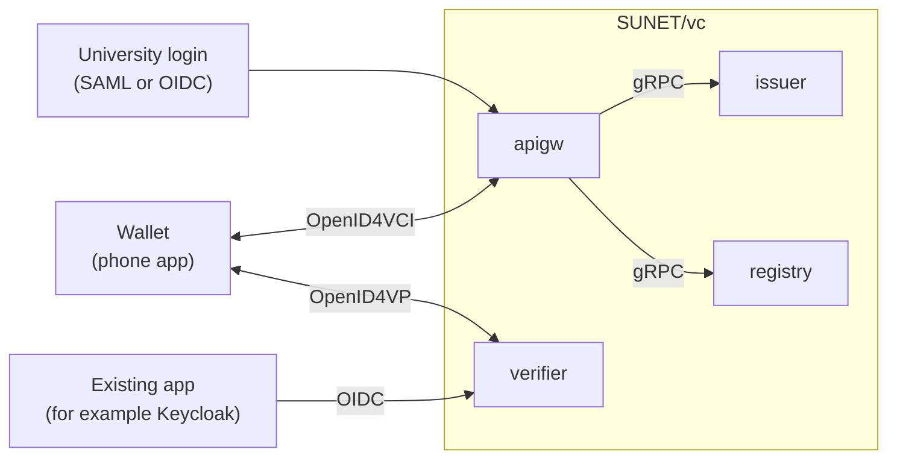
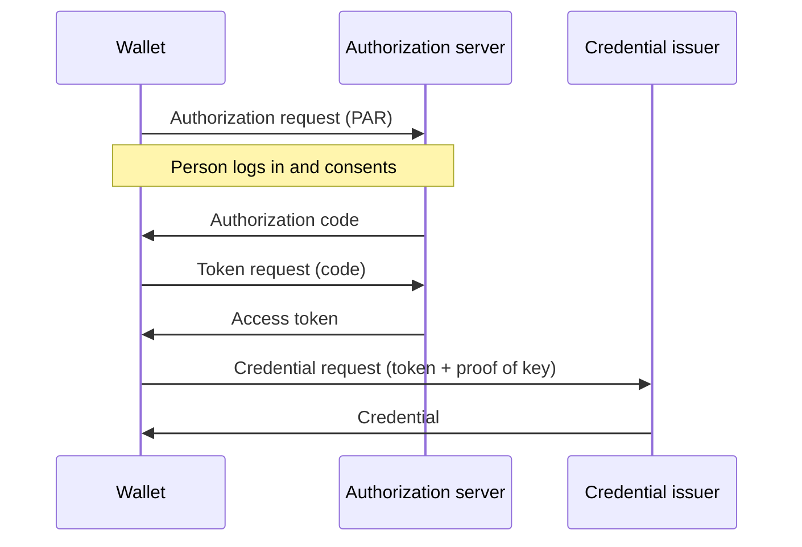
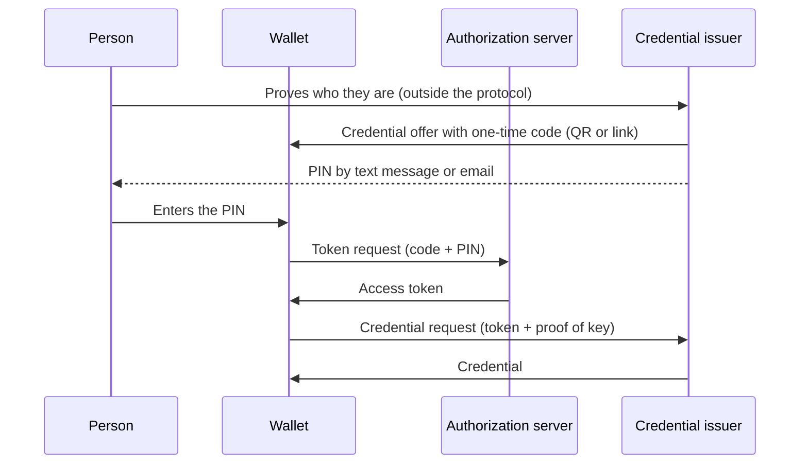
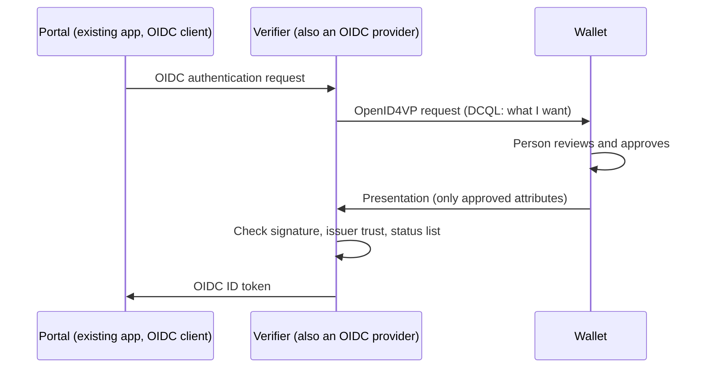
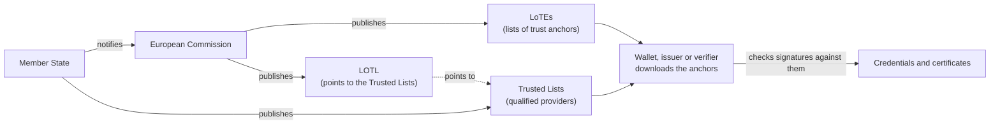
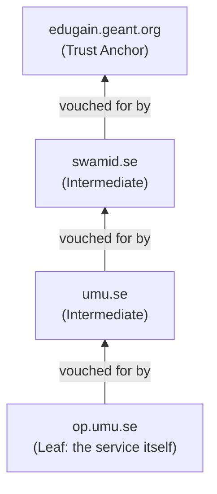

# Digital identity for universities: a crash course

A map of the field, written to be read at home after the session.

**Who this is for:** a project manager with a technical background who is new to digital identity.
**What it gives you:** the vocabulary, the main players, how our systems fit together, and a way to stay calm when the acronyms start.
**What it does not give you:** protocol details you will never need, or legal text.

How to read it: sections 1 to 4 are the map. Sections 5 to 11 are our world. Sections 12 and 13 are practical. Appendices A and B go deeper on two formats and can be skipped on a first read. Appendix C lists the sources.

> **Status of statements about our code.** Everything here about what SUNET/vc does comes from reading its repository in November 2026.

---

## 1. Why this matters

Today a student proves who they are by logging in at their university. That works inside Sweden's university sector because the universities trust each other through a federation (see section 6).

The next step is different. The student gets a **wallet** on their phone. The wallet holds **credentials** such as a national identity, a diploma, or a micro-credential. The student shows those credentials to anyone, anywhere in the EU, and the other party can check them without calling the university.

The EU has made this law. The European Digital Identity Regulation requires each Member State to offer a wallet. DC4EU's own website states the deadline as 2026. That date has not been met yet, so check the current timetable.

How this can affect a university. The first point follows as soon as a university accepts any wallet credential. The other two are choices:

1. **Deciding whom to trust.** A credential is only worth something if the receiver trusts its issuer. A university that accepts a wallet credential from an applicant, such as a national identity or a diploma from another country, has to decide which issuers it believes. This is mostly about governance, not code.
2. **Possibly becoming a verifier.** A university can choose to accept wallet credentials from applicants and exchange students instead of paper copies and manual checks.
3. **Possibly becoming an issuer.** A university can choose to issue diplomas, student status or micro-credentials into students' wallets, so that others can trust them without calling the university.

---

## 2. The one picture to remember

Every credential system, anywhere, has the same three roles.



The key idea: **the verifier never has to contact the issuer to accept a credential.** The credential carries a signature. The verifier checks the signature and checks that the issuer is on a list of parties it trusts. That second check is the whole game, and it is why this field talks so much about "trust".

In EU terminology the roles are named like this:

| Plain word | EU term |
|---|---|
| Issuer of identity | PID Provider |
| Issuer of anything else | Attestation Provider |
| Holder | Wallet User (their wallet is a Wallet Unit) |
| Verifier | Relying Party |

---

## 3. Twenty words you will hear in the first week

| Word | Plain meaning |
|---|---|
| **eIDAS 2.0** | The EU law that creates the European digital identity wallet. Its official name is the European Digital Identity Regulation. |
| **EUDI Wallet** | The wallet app each Member State must provide. EUDI = EU Digital Identity. |
| **ARF** | Architecture and Reference Framework. The EU's long technical blueprint for the wallet. |
| **Attribute** | A single fact about someone: a name, a birth date, a degree. |
| **Attestation / credential** | A signed bundle of attributes. The two words mean nearly the same thing. The EU says "attestation". |
| **PID** | Person Identification Data. The core identity credential: who you are. |
| **EAA** | Electronic Attestation of Attributes. Any non-identity credential, such as a diploma. |
| **QEAA** | A *qualified* EAA, issued by a Qualified Trust Service Provider. It has the highest legal weight. |
| **PuB-EAA** | An EAA issued by a public sector body, or on its behalf, from an authentic source. |
| **Authentic source** | The system of record that is the primary source of a fact, for example a student registry. |
| **QTSP** | Qualified Trust Service Provider. A company or body certified to issue legally strong trust services. |
| **Wallet Provider** | The organisation that builds and runs a wallet and vouches for it. |
| **Selective disclosure** | Showing one attribute without showing the others. "Over 18" without the birth date. |
| **Revocation / status list** | A published list that tells verifiers whether a credential is still valid. See Appendix B. |
| **Relying Party access certificate** | Proves *who* a verifier or issuer is. A kind of ID card for the service. |
| **Relying Party registration certificate** | Proves *what* a verifier is registered to ask for. A permit. |
| **Trust anchor** | The party you trust without further proof. Everything else is checked back to it. |
| **Trust framework** | The rules and lists that decide who counts as trusted. |
| **Federation** | A group of organisations that agree to trust each other under shared rules. |
| **Trust mark** | A signed badge saying an entity meets a stated requirement. |

Six protocol words, for when you sit in a technical meeting:

| Word | Plain meaning |
|---|---|
| **OpenID4VCI** | The standard way a wallet *receives* a credential from an issuer. VCI = Verifiable Credential Issuance. |
| **OpenID4VP** | The standard way a wallet *presents* a credential to a verifier. VP = Verifiable Presentations. |
| **SD-JWT VC** | A credential format built for selective disclosure. It is JSON-based. See Appendix A. |
| **mdoc** | A credential format from ISO 18013-5, the mobile driving licence standard. Compact, binary. |
| **DCQL** | Digital Credentials Query Language. How a verifier says exactly what it wants from the wallet. |
| **Code flow / pre-authorized code flow** | The two ways OpenID4VCI hands a credential to a wallet. Either the person logs in during the flow, or the issuer checked them before it. See section 8. |

---

## 4. Who owns which standard

Nobody owns "digital identity". Several bodies each own a layer. When someone says "the spec", ask which body wrote it.

| Layer | Body | Examples |
|---|---|---|
| Law and architecture | European Commission, Member States | European Digital Identity Regulation, the ARF |
| Wallet protocols | OpenID Foundation | OpenID4VCI, OpenID4VP, HAIP, OpenID Federation |
| Credential formats | IETF, ISO, W3C | SD-JWT VC (IETF), mdoc (ISO), Verifiable Credentials 2.0 (W3C) |
| Certificates and trust lists | ETSI | Access certificates (TS 119 411-8), registration certificates (TS 119 475) |
| Browser API | W3C community group | Digital Credentials API |
| Education data models | EU education bodies | European Learning Model (ELM) |

**HAIP** is the "High Assurance Interoperability Profile". It picks one consistent set of options out of the OpenID specs so that wallets and issuers from different vendors work together. It became final in December 2025.

Two facts worth keeping:

- The protocols are young. OpenID4VP became final in July 2025 and OpenID4VCI in September 2025.
- OpenID Federation 1.0 became final in February 2026, after about ten years of drafts. A newer 1.1 followed in May 2026.

---

## 5. The EU wallet in plain words

The ARF describes an ecosystem. Here is the short version.

- **A person** gets a wallet from a **Wallet Provider**.
- A **PID Provider** puts the person's identity into the wallet as a PID. In Sweden that will follow national rules.
- **Attestation Providers** (universities, hospitals, registries) add other credentials.
- **Relying Parties** (banks, services, other universities) ask the wallet for facts.
- Before a verifier asks, it has a **registration** with a national **Registrar**. The registration lists what it may ask for.
- The wallet itself proves to issuers that it is a genuine, certified wallet. This is the **wallet attestation**.

Why this is more than technology: every arrow above needs someone responsible and accountable. The EU sets the rules. Each Member State decides who plays which role. That is why project work here is full of "who is allowed to do what" questions.

Two EU projects test this with real pilots. Both matter to us.

| | DC4EU | WE BUILD |
|---|---|---|
| Full name | Digital Credentials for Europe | Wallet Ecosystem for Business and Payments |
| Focus | Education and social security | Business, supply chain and payments |
| Education link | Educational credentials and professional qualifications | A use case on issuing micro-credentials and verified skills |
| Other use cases | Portable Document A1, European Health Insurance Card | 13 use cases in total |
| Size | 80 institutions, 22 countries | More than 200 organisations, 28 countries |
| Status | Concluded. Closing conference in Madrid, 11 July 2025. | Launched September 2025. Year two runs the actual pilots. |
| Why it matters to us | Our flagship code base started here | Our micro-credential metadata is aligned with its rulebook 1.0 |

Source: the two project websites, read in November 2026.

---

## 6. SUNET and the Swedish university sector

**SUNET** runs the Swedish university network and the identity services around it.

**SWAMID** is the Swedish academic identity federation, run by SUNET. It works with SAML. A student logs in at their own university's **identity provider (IdP)**. A **service provider (SP)**, which is the service the student wants to use, receives a **SAML assertion** from the IdP: a signed statement about who the student is. The service accepts it because SWAMID publishes signed **metadata** that lists every member IdP and SP. Both sides trust the list, so they do not need to know each other in advance.



**eduGAIN** connects national federations like SWAMID across countries. It is the same idea one level up.

**eduID** is a SAML2 identity provider. SUNET/vc can use it as the login step when issuing: the person logs in at eduID, and the credential is built from the attributes in the SAML assertion that eduID returns.

This is our strength. The university sector has run federated trust for over a decade. The wallet world is learning to do what we already do, and **OpenID Federation** is the bridge: it takes the federation idea and puts it on the web in a way wallets and issuers can use (section 10). In the EU wallet model, trusted lists come first (section 9).

Put side by side: SWAMID is today's trust list for SAML logins. The wallet world needs the same kind of shared trust for issuers and verifiers.



What the project focus document for our code lists as university use cases:

- Diploma, European Learning Model (ELM) and micro-credentials as issuable and verifiable credentials.
- Student mobility across borders using a PID plus ELM, for example Erasmus.
- Login with a wallet at existing services, through a standard login server in front.

---

## 7. A tour of our code: SUNET/vc

Our flagship project is open source at `github.com/SUNET/vc`. It is written in Go. It started inside DC4EU. Its README describes it as a "backend for issuing and verifying digital credentials".

It supports the main credential formats (SD-JWT VC, W3C Verifiable Credentials 2.0, and ISO mdoc) and the two key protocols (OpenID4VCI 1.0 and OpenID4VP 1.0).

It has four services:

| Service | What it does, in one sentence |
|---|---|
| **apigw** | The front door. Wallets talk to it to receive credentials. It also handles login with SAML or OIDC. |
| **issuer** | Signs the credentials. Can use a hardware security module for keys. |
| **verifier** | Checks credentials a wallet presents. Can also act as a normal OIDC provider for other apps. |
| **registry** | Keeps the revocation lists (Token Status Lists). |



Two details worth knowing:

1. **Issuing needs the person to be authenticated first.** The service can do that in several ways, for example a university login (SAML or OIDC), or by asking the wallet to present a credential it already holds, such as a PID. Which way is a configuration choice per credential type. Section 8 explains the two issuing flows.
2. **Login with a wallet needs no change to existing apps.** The verifier looks like an ordinary OIDC provider to the app. Behind it, it asks the wallet. That is how a university service can accept wallet credentials without rewriting anything.

More features, only if asked: browser presentation through the W3C Digital Credentials API, zero-knowledge proofs for privacy (section 11), OpenID Federation endpoints, and checks against EU access and registration certificates.

Honest status, from the repository's own focus document: feature breadth is already high. The current bottleneck is *provable interoperability and production readiness*, meaning conformance tests, public test deployments, and high availability. A good project manager question: "What do we need to show that it works with other people's wallets?"

---

## 8. One flow, start to finish

Receiving a credential and then using it. Real message names are in bold. Based on the SUNET/vc README and the OpenID specs.

### Two ways to get a credential

OpenID4VCI has two flows for issuing a credential. They differ in one thing: when the issuer finds out who the person is.

- In the **authorization code flow** (often just "code flow"), the person proves who they are during the flow, usually by logging in.
- In the **pre-authorized code flow**, the issuer has already checked the person before the flow starts. It hands the wallet a one-time code instead.

| | Authorization code flow | Pre-authorized code flow |
|---|---|---|
| When the issuer learns who the person is | During the flow. The person logs in and consents. | Before the flow, in the issuer's own process. The protocol does not say how. |
| Login and redirects | Yes. The person is sent to the issuer's authorization endpoint. | No. The authorization endpoint is not used. |
| How it starts | With an offer from the issuer, or with the wallet on its own | Always with an offer. The offer carries the code. |
| What the wallet trades for the access token | An authorization code | A pre-authorized code, plus an optional PIN |
| Main risk | More moving parts: redirects, login, consent | Anyone who holds the code can get the credential |
| Typical fit | The person already has a login at the issuer, such as a university account | The issuer already knows the person: an office visit, a letter, a back-office decision |
| In HAIP | Required | Not required |
| In the OpenID4VCI spec | Section 3.4 | Section 3.5 |

Both flows end the same way. The wallet gets an **access token**, calls the **credential endpoint**, proves it holds the key, and receives the credential.

Two everyday examples. A student clicks "request your diploma" on the university website, the wallet opens, and the student logs in at the university. That is the code flow, and it is the spec's own same-device example. In the other example, a student is checked at an office and then receives a letter or an email with a QR code, and a PIN by text message. That is the pre-authorized flow. The spec's own example of it is an employer handing out an employee credential.

### Part A1: getting a credential with the authorization code flow

1. The wallet gets a **credential offer** (a QR code or a link) from the issuer, or starts on its own.
2. The wallet sends a **pushed authorization request (PAR)** to the apigw. The apigw acts as an OAuth authorization server.
3. The person proves who they are. In this example they are sent to their university login (SAML or OIDC).
4. The person sees a **consent** screen and agrees.
5. The wallet gets an **authorization code** and exchanges it at the **token endpoint** for an **access token**. The token is bound to the wallet with **DPoP**.
6. The wallet calls the **credential endpoint** and proves it holds the key the credential will be bound to.
7. The apigw asks the issuer (internally over gRPC) to **sign** the credential. The wallet stores it.



### Part A2: getting a credential with the pre-authorized code flow

1. Before the wallet is involved, the issuer finds out who the person is, in its own process. It could be a web form, an office visit or a back-office check. The OpenID spec does not say how.
2. The issuer creates a **credential offer** that contains a **pre-authorized code**. The code must be short-lived and single use. The issuer shows the offer as a QR code or a link.
3. If the issuer wants a second check, the offer says that a **transaction code** is required. This is a PIN, and the spec calls it `tx_code`. The issuer sends the PIN by another route, for example a text message.
4. The wallet reads the offer and fetches the issuer's **metadata**.
5. The wallet sends the code, and the PIN if one is needed, to the **token endpoint** and gets an **access token**. There is no login and no redirect.
6. The wallet calls the **credential endpoint** and proves it holds the key the credential will be bound to.
7. The issuer signs the credential. The wallet stores it.



### Why the pre-authorized flow needs extra care

- **The offer cannot be trusted by itself.** Nobody signs it. The wallet has to check the issuer exactly as if the wallet had started the flow, because an attacker could send a fake offer.
- **Replay.** The code is not tied to a session. Someone who photographs the QR code could use it before the real person does. The defences are a short life, a single use, and the PIN sent by another route.
- **PIN phishing.** An attacker can run a fake issuer and at the same moment trigger a real PIN from another service, for example a payment service. The person types the PIN into the wallet, and the fake issuer receives it. The spec recommends that the wallet only deals with issuers it trusts. That is one more reason trust lists matter (section 9).

### Which flow do we use?

- HAIP requires wallets and issuers to support the authorization code flow, together with PKCE, pushed authorization requests and DPoP. It does not require the pre-authorized flow. So the code flow is the one every HAIP wallet can be expected to support.
- SUNET/vc supports both flows. Its issuer metadata advertises both grant types by default. A credential can be set up so that it is issued only through a pre-authorized offer, and wallet-initiated requests for it are rejected. The pre-authorized flow also supports PINs, and the code is forfeited after too many wrong attempts. This comes from the repository code.
- Questions worth asking: "How does the issuer know who the person is today: a login, or a decision in a back office?" "Does the offer need a PIN, and how does the PIN reach the person?" "Which flow does the other party's wallet support?"

### Part B: showing a credential (OpenID4VP)

1. A service (say, an admissions portal) needs a fact. It sends the person to the verifier with an ordinary **OIDC authentication request**. Towards the portal, the verifier plays the role of an OIDC provider (OP), and the portal is the OIDC client.
2. The verifier builds an **OpenID4VP request**. It identifies itself with its certificate and states exactly what it wants using **DCQL**.
3. The wallet shows the person what is asked and who is asking. The person approves.
4. The wallet sends back a **presentation** containing only the approved attributes (**selective disclosure**).
5. The verifier checks the issuer's signature, checks the issuer is trusted, and checks the **status list** to see if it was revoked.
6. The verifier hands the portal a standard OIDC **ID token**. The portal never saw a credential.



If you remember one thing: **the portal needs no knowledge of wallets.** That is a design choice, and it is what makes adoption realistic.

### How the verifier treats an mdoc

SUNET/vc verifies mdoc presentations as well as SD-JWT VC. The steps below come from `pkg/mdoc` and `internal/verifier`.

1. The verifier checks the issuer's signature over the MSO (the Mobile Security Object, a signed list of hashes of every data element). It checks the issuer's certificate chain against the trust service (section 9).
2. It checks that the MSO is version 1.0, that its document type matches what was asked for, that its digest algorithm is SHA-256 or SHA-512, and that it is inside its validity period.
3. It checks each data element against the hashes in the MSO.
4. It checks device authentication: proof that the presenting phone holds the key the issuer bound the mdoc to, tied to this session. According to a code comment, the session-bound path accepts a device signature only, because the verifier has no session key to check a MAC.
5. It refuses a response that carries two documents of the same type.

Two details matter for revocation. Only the status reference inside the verified MSO is used. A data element that is itself called `status` is refused, so it cannot hide the signed reference.

One limit: a zero-knowledge mdoc presentation (`mso_mdoc_zk`) is refused with an "unsupported format" error in the apigw presentation handler. A code comment there says the proof path is not wired in. A native proof verifier exists in `pkg/mdoc/zknative`, but no place where it is used was found.

---

## 9. Trusted lists: how trust works first

The EU wallet decides whom to trust with published lists. We start there. OpenID Federation is the next step (section 10).

**Watch one acronym.** In our code repository, "TSL" means *Token Status List*, the revocation list from section 3 and Appendix B. A *Trusted List* is a different thing.

### The idea

An authority publishes a signed list of trusted parties. Each entry carries a **trust anchor**: the public key or certificate to check signatures against. A verifier downloads the list, keeps the anchors, and checks every credential and certificate against them. If a party is marked invalid on the list, it stops being trusted.

The ARF uses two kinds of list, and there is a third list that points to the first kind:

| List | Published by | Based on |
|---|---|---|
| **Trusted List** | Member States | ETSI TS 119 612 |
| **LOTL** (List Of Trusted Lists) | The European Commission | ETSI TS 119 612 |
| **LoTE** (List of Trusted Entities) | The European Commission | ETSI TS 119 602 |

The LOTL does not list providers. It lists the Trusted Lists, so a verifier can find every Member State's list from one place and check that each list is genuine. Do not confuse it with a LoTE, which lists trust anchors for the wallet ecosystem itself.



### Who is on which list

| Party | Where its trust anchors go |
|---|---|
| Wallet Provider | Wallet Provider LoTE, after the Member State notifies the Commission |
| PID Provider | A LoTE, after notification to the Commission |
| PuB-EAA Provider | A LoTE, after notification to the Commission |
| QEAA Provider | A Trusted List, once it has qualified status |
| Non-qualified EAA Provider | Not in a LoTE. The attestation's rulebook says how a verifier finds the anchor. |
| Access Certificate Authority | A LoTE |
| Provider of registration certificates | A LoTE |

### What each party does with the lists

- **A verifier** downloads the latest lists regularly and keeps the anchors, sorted by type of credential. It checks each credential's signature against them. If an entry is invalidated, it removes the anchor.
- **A wallet** takes the anchors of the Access Certificate Authority and of the registration certificate providers from the LoTEs. It uses them to check a verifier's certificates before it shows anything to the person.
- **An issuer** downloads the Wallet Provider LoTE. It uses the anchors to check that a wallet is genuine before issuing into it.

### Lists say who, certificates say what

The list says "this party's keys are trusted". Two certificates add detail, as in section 3: the access certificate says *who* the party is, and the registration certificate says *what* it is registered for. Registration is for transparency. It does not authorise anyone to issue or request a given type.

### Where this matters for a university

- **Accepting credentials.** A university verifier needs the right anchors to check a PID or a diploma from elsewhere.
- **Being trusted as an issuer.** What a university must do depends on the category of its credentials. A PuB-EAA provider goes through notification to a LoTE. A QEAA provider goes on a Trusted List once qualified. A plain EAA provider is on no list, and the rulebook decides. Which category a university's credentials fall into is a policy and legal question, not a technical one. Ask early.

### How this shows up in our code

Trust decisions in SUNET/vc go to a separate trust service (a policy decision point), built on SUNET's go-trust. It answers "is this key trusted for this role?". The configuration documentation names trust frameworks per role, with example values such as `etsi-tl`, `x509`, `did:web` and `openid-federation`. The repository's ARF gap analysis marks trusted list and LoTE lookup as covered.

### Trusted lists and federation side by side

Both answer one question: should I trust this issuer? They differ in how the answer arrives.

| | Trusted list | OpenID Federation |
|---|---|---|
| Shape | One published list of trust anchors | A chain of signed statements, entity by entity |
| Who maintains it | An authority: a Member State or the Commission | Each entity publishes about itself, and authorities above vouch for those below |
| What the verifier does | Downloads the list and keeps the anchors | Follows the chain up to a trust anchor |
| Our plan | First step | Next step |

---

## 10. OpenID Federation in five minutes

We are working on OpenID Federation. Here is the idea without the jargon.

**Problem:** a verifier receives a credential from an issuer it has never met. How does it know the issuer is genuine?

**Idea:** every party publishes a signed statement about itself at a fixed web address (`/.well-known/openid-federation`). Each party also names the authority above it. Authorities sign statements about the parties below them. Follow the signatures upward until you reach someone you already trust. That chain is a **trust chain**.

The specification's own example uses our world. An OpenID Provider at Umeå University is vouched for by Umeå, which is vouched for by SWAMID, which is vouched for by eduGAIN.



Vocabulary, mapped to the picture:

| Term | Meaning |
|---|---|
| **Entity** | Anyone in the federation: a service, a university, a federation. |
| **Entity Configuration** | The signed statement an entity makes about itself. |
| **Subordinate Statement** | The signed statement an authority makes about an entity below it. |
| **Trust Anchor** | The top of a chain. Verifiers are configured to trust it. |
| **Trust Chain** | The sequence of statements from the entity up to the trust anchor. |
| **Trust Mark** | A signed badge saying an entity meets a named requirement. |
| **Metadata policy** | Rules from above that limit what entities below may claim. |

Three useful properties:

- Trust is established by *signatures*, not by ordinary web certificates.
- Authorities can set rules for everyone below them, and nobody below can loosen those rules.
- One entity can belong to several federations at once.

Our verifier and apigw can already publish an Entity Configuration. It is switched off by default.

---

## 11. Zero-knowledge proofs: proving without showing

One idea, kept short. You will hear "ZKP" more often as the wallet matures.

### The problem it solves

Selective disclosure (section 3 and Appendix A) hides the attributes you do not show. But the credential still carries the issuer's signature and the same fingerprints every time. Two verifiers who compare notes can tell it is the same credential, and so the same person. That is linkability.

A **zero-knowledge proof** (ZKP) goes one step further. The wallet does not send the credential, or parts of it. It sends a *proof* that a statement is true, for example "this person is over 18, and a trusted issuer signed the credential behind that answer". The verifier learns the answer and nothing else. A fresh proof is made for every verifier, so proofs cannot be matched.

Think of a doorman. With selective disclosure you show a card with one line on it. With a zero-knowledge proof you show no card, and the doorman still gets a trustworthy yes.

| | Selective disclosure (SD-JWT VC, mdoc) | Zero-knowledge proof |
|---|---|---|
| What the verifier receives | The chosen attributes, the issuer's signature and the fingerprints | A proof, and the answer to the question asked |
| Can two verifiers link the presentations? | Yes, by comparing the signature | No. Each proof looks different. That is the aim. |
| "Over 18", worked out from a birth date | Only if the issuer put a ready-made "over 18" attribute in the credential | The wallet works it out from the birth date |
| Cost | Light and easy to debug | Heavier: more computation, harder to debug |
| Maturity | Established | Early. The standards are still moving. |

### Two families

The ARF's discussion paper (topic G) follows ETSI's split into two kinds of scheme.

- **Special signatures (the BBS family).** The issuer signs in a way designed for hiding. It is fast and compact, but the issuer has to change how it signs, and the schemes are not widely supported yet.
- **Proofs over existing credentials (zk-SNARK style).** The wallet builds a proof over an ordinary credential, such as an ISO mdoc, so the issuer changes nothing. The price is computation, and a small program for each kind of question. The paper says some of these schemes may need several seconds per proof and tens or hundreds of megabytes of helper data per credential type.

### What the EU says

- The Regulation asks for it. Recital 14 says Member States should integrate privacy-preserving technologies such as zero-knowledge proofs into the wallet. Article 5a requires techniques that ensure unlinkability where the attestation does not require identifying the user.
- It is a feature for after launch. The discussion paper (version 1.4, March 2025) expects ZKP support to arrive after the wallet goes live, and wants proofs to work on credentials that are already issued, in the mdoc and SD-JWT VC formats. The ARF has moved on since then and now lists technical specifications for ZKP, so check the current status before you quote this.
- Not everything can be unlinkable. Opening a bank account needs the person's identity, so there is nothing to hide.
- Uses the paper lists: prove one attribute, prove "I hold an attestation of this type" (a student discount, say), prove you are a person instead of solving a CAPTCHA, and derive a pseudonym per service so a returning user is recognised without being identified.
- A proof can even show that the issuer is on a trusted list without saying which issuer (section 9).

### In our code

The verifier in SUNET/vc can ask for a zero-knowledge presentation. The DCQL format is `zkp_req`, profiled by the EUDI `nym_auth` rulebook. The verifier names a function, such as `age_check` or `pseudonym`. The wallet computes it inside the proof, and only the result comes back. The default source credential is an ISO mdoc. Code comments say the rulebook and the specifications below it are still moving. This comes from reading one source file in the repository, not from the project documentation.

### What to ask

- "Does the verifier need to know who the person is, or only a fact about them?"
- "Which scheme is it, and which body standardised it?"
- "Does it work on the credentials we have already issued?"
- "How long does a proof take on an ordinary phone?"

If you remember one thing: **selective disclosure hides what you do not show. A zero-knowledge proof also hides the fingerprints.** It is where privacy is heading. Selective disclosure is the tool for now.

---

## 12. Nobody knows everything: the numbers

A fun fact to keep in your pocket.

The OpenID Foundation publishes its specifications in one directory, `openid.net/specs`. The latest version of each specification was counted, and file sizes were converted to approximate printed pages.

| Measure | Estimate |
|---|---|
| Distinct specifications listed | 97 |
| Pages across the latest version of each | about 1,330 |
| Pages in the families active today (excluding retired or inactive OpenID 2.0, HEART, iGov, MODRNA, FastFed, OpenYOLO) | about 1,060 |
| Pages in the Connect family alone | about 350 |
| Pages in the Federation family | about 235 |
| Pages in OpenID4VC (issuance, presentation, HAIP) | about 145 |

That is *one* organisation. It leaves out:

- every supporting RFC (OpenID Federation 1.0 alone cites 23),
- the ISO, ETSI and W3C standards,
- the ARF and the EU regulations,
- every draft version.

A rough guess, not a measurement: everything touching our work adds up to several thousand pages. Nobody on earth has read it all, and the people who write it specialise in one corner each. OpenID Federation 1.0 itself went through about 50 numbered drafts over roughly ten years.

**What this means for you:** the job is not to know everything. The job is to know the map, know who specialises in which corner, and ask good questions. 

---

## 13. Working in this field

### Questions that show you understand

- "Which role are we playing here: issuer, verifier, or both?"
- "Who is the trust anchor, and who decided that?"
- "Is that in the final spec, or still a draft?"
- "What happens when a credential is revoked? Who runs the list?"
- "Has this been tested with someone else's wallet?"

### Red flags

- "It's standard" without naming which standard or which version.
- Someone saying a spec is stable when it is a draft. Check the status on openid.net.
- No named owner for who may become an issuer.
- A demo that works only with its own wallet.

### Where the real risk sits

For a project manager, the hard risks are rarely the cryptography. They are:

1. Moving standards. Several still changed in 2025 and 2026.
2. Interoperability. Two correct implementations can still fail to work together.
3. Governance. Who may issue? Who runs the registry? Who pays?
4. Dependencies between EU projects and national decisions.

### Good sources

**The EU wallet**
- [EU Digital Identity Wallet architecture and reference framework (ARF)](https://github.com/eu-digital-identity-wallet/eudi-doc-architecture-and-reference-framework). Start with Annex 1, the definitions.
- [ARF chapter 6, the trust model](https://eudi.dev/latest/main/06-trust-model/): read 6.3 and 6.6 for how trusted lists and LoTEs are used.
- [ARF discussion topic G, zero-knowledge proofs](https://eudi.dev/latest/discussion-topics/g-zero-knowledge-proof/): the EU's thinking on ZKP, in plain enough language.
- [EU Digital Identity Wallet home page](https://ec.europa.eu/digital-building-blocks/sites/display/EUDIGITALIDENTITYWALLET/EU+Digital+Identity+Wallet+Home), on the European Commission site.

**The EU projects**
- [DC4EU](https://www.dc4eu.eu/): education and social security. Concluded.
- [WE BUILD](https://www.webuildconsortium.eu/): business and payments. Read the use cases, especially micro-credentials.

**The protocols (OpenID Foundation)**
- [Specification index](https://openid.net/specs/) and the [developer overview](https://openid.net/developers/specs/).
- [OpenID4VCI 1.0](https://openid.net/specs/openid-4-verifiable-credential-issuance-1_0.html): receiving a credential.
- [OpenID4VP 1.0](https://openid.net/specs/openid-4-verifiable-presentations-1_0.html): presenting a credential.
- [OpenID Federation 1.0](https://openid.net/specs/openid-federation-1_0.html): read the introduction, section 2 and the spec's own Appendix A (the worked example).
- [HAIP 1.0](https://openid.net/specs/openid4vc-high-assurance-interoperability-profile-1_0.html): the interoperability profile.

**The formats and the browser**
- [W3C Verifiable Credentials Data Model 2.0](https://www.w3.org/TR/vc-data-model-2.0/).
- [SD-JWT VC](https://datatracker.ietf.org/doc/draft-ietf-oauth-sd-jwt-vc/) (IETF draft).
- [Token Status List](https://datatracker.ietf.org/doc/draft-ietf-oauth-status-list/) (IETF draft): the revocation list.
- [ISO/IEC 18013-5](https://www.iso.org/standard/69084.html) (mdoc).
- [W3C Digital Credentials API](https://wicg.github.io/digital-credentials/).

**Our own code: [SUNET/vc](https://github.com/SUNET/vc)**
- `README.md`: the overview and architecture diagrams.
- `docs/TRUST_AND_IDENTITY.md`: trust, certificates, federation.
- `docs/PROJECT_FOCUS.md`: where the project is heading.
- `ROADMAP.md`: planned work.
- `docs/ARF_3_0_GAP_ANALYSIS.md`: how we compare to the ARF.

---

## Appendix A. SD-JWT VC, a closer look

You will hear "SD-JWT VC" almost daily, so it is worth knowing what is inside. The name stacks three ideas:

- **JWT**: a JSON document with a digital signature. It is the same building block that OpenID Connect uses for ID tokens.
- **SD**: selective disclosure. The issuer signs the credential so that each attribute can be shown or hidden separately.
- **VC**: a credential profile on top. It adds a *type* (what kind of credential this is) and a few standard fields. The profile is an IETF draft. The selective-disclosure part, SD-JWT, is already a final standard (RFC 9901, November 2025).

**How the trick works.** The issuer does not put the readable attributes in the signed part. For each attribute it makes a small package called a **disclosure**: a random value (a salt), the attribute name, and the value. It then puts only the **hash** of each package into the signed JWT. A hash is a fingerprint. It proves a package is genuine but does not reveal what is in it.

The wallet receives the signed JWT and all the disclosures. When it presents the credential, it sends the signed JWT plus only the disclosures the person approved. The verifier hashes each disclosure it receives and checks that the hash appears in the signed JWT. The attributes that were left out stay hidden, because a hash cannot be turned back into the value.

The salt matters. Without it, anyone could guess "Master of Science in Computer Science" or "Drottninggatan", hash the guess, and compare it with the fingerprint.

**A very simple example.** A university issues a degree credential. The signed JWT carries the fixed fields and the fingerprints. Two attributes can be hidden: the degree, and the street name in the address. The country in the address is always visible. The values below are shortened and illustrative, not real.

The signed part, as readable JSON:

```json
{
  "iss": "https://issuer.example-university.se",
  "iat": 1767225600,
  "exp": 1798761600,
  "vct": "https://example-university.se/credentials/degree",
  "cnf": { "jwk": { "kty": "EC", "...": "the wallet's public key" } },
  "_sd": [
    "hash of the degree disclosure"
  ],
  "address": {
    "country": "SE",
    "_sd": [
      "hash of the street name disclosure"
    ]
  },
  "_sd_alg": "sha-256"
}
```

The two disclosures the wallet also receives, shown here as readable JSON (on the wire each one is base64url encoded):

```json
["3b9d77...salt", "degree",      "Master of Science in Computer Science"]
["c04e5a...salt", "street_name", "Drottninggatan"]
```

How a fingerprint in `_sd` is made, in one line:

```text
_sd entry = base64url( SHA-256( base64url( JSON array of [salt, name, value] ) ) )
```

Read it from the inside out. The array is written as JSON and base64url encoded. That string is the disclosure the wallet carries. Its text is hashed with SHA-256, and the 32-byte result is base64url encoded again to give the entry in `_sd`. The verifier repeats the same steps on each disclosure it receives and looks for the result in `_sd`.

Notice the `address` object. It sits in the signed part in the open, and `country` is readable by anyone who gets the credential. The `street_name` is not in the object at all. Only its fingerprint is, in a second `_sd` list inside `address`. Selective disclosure works at any level of the JSON, not only at the top.

What the pieces mean:

| Field | Meaning |
|---|---|
| `iss` | Who issued it. The verifier looks the issuer up in a trust list (section 9). |
| `iat` and `exp` | Issued at and expires, as Unix timestamps. |
| `vct` | The credential type. It tells the verifier what the attributes mean. |
| `cnf` | The wallet's public key. It ties the credential to one wallet. |
| `address` | A nested object. `country` is visible to everyone. |
| `_sd` | The fingerprints of the hidden attributes at that level. The one inside `address` covers `street_name`. |

A verifier only needs the degree. The wallet sends the signed JWT and only the degree disclosure. The street name never leaves the phone, but the verifier still sees the country. Everything is joined with `~` characters into one string:

```text
<signed JWT> ~ <degree disclosure> ~ <key binding JWT>
```

The last part is the **key binding JWT**. The wallet signs a short proof with the key named in `cnf`, plus the verifier's name and a fresh random value. That shows the credential was presented by its real holder and cannot be replayed to someone else.

**Know the limits.**

- Each presentation reveals the issuer's signature and the fingerprints. If the same person shows the credential to two verifiers, those verifiers can recognise that it is the same credential and compare notes. This is called *linkability*. Zero-knowledge proofs address it (section 11).
- SD-JWT VC is JSON, so it is easy to read and debug. mdoc (the ISO format) is binary and compact, and it comes from the physical driving licence world. Both do selective disclosure, and the EU wallet supports both.
- The type in `vct` only helps if verifiers and issuers agree on what it means. This is a governance question as much as a technical one.

---

## Appendix B. Revocation: Token Status List, a closer look

A credential is signed once and then lives in the wallet. The issuer must still be able to say "this one is no longer valid": the student left, the degree was withdrawn, the phone was lost. The verifier never calls the issuer (section 2), so the answer has to come from somewhere else. That is the **status list**.

The standard is the IETF **Token Status List**. It is draft-ietf-oauth-status-list-21 (June 2026) and sits in the RFC Editor queue, so the final RFC number is not known yet. Check its status before you quote it. In our code repository, "TSL" means this list.

**How it works.**

1. The issuer keeps one long row of status values, one per credential it has issued. Each value takes `bits` bits: 1, 2, 4 or 8. The defined values are `0x00` valid, `0x01` invalid (revoked) and `0x02` suspended. `0x03` and `0x0C` to `0x0F` are left for the application. Suspended needs the value 2, so the list must use at least 2 bits per entry. With 1 bit per entry the list can only say valid or revoked.
2. When the issuer signs a credential, it gives the credential a position in the row. The credential carries a `status` claim with the address of the list (`uri`) and the position (`idx`).
3. The issuer compresses the row, signs it as a *status list token*, and publishes it at that address. The token has an expiry and a `ttl` that tells verifiers how long they may keep their copy.
4. To revoke a credential, the issuer flips its bit and publishes a new signed list.

The extra claim in the credential, shortened. It sits next to `iss`, `vct` and the others from the example above:

```json
"status": {
  "status_list": {
    "idx": 4711,
    "uri": "https://issuer.example-university.se/statuslists/1"
  }
}
```

The published list token, as readable JSON. The values are illustrative:

```json
{
  "sub": "https://issuer.example-university.se/statuslists/1",
  "iat": 1767225600,
  "exp": 1767312000,
  "ttl": 43200,
  "status_list": { "bits": 1, "lst": "the compressed bit row, base64url" }
}
```

| Field | Meaning |
|---|---|
| `idx` | The credential's position in the row. |
| `uri` | Where the list is published. It must match `sub` in the list token. |
| `sub` | The address of the list. The verifier compares it with `uri` in the credential. |
| `exp` and `ttl` | When the list expires, and how long a verifier may keep its copy before it fetches again. |
| `bits` | How many bits each credential gets: 1, 2, 4 or 8. `1` gives valid or revoked. `2` also fits suspended (value `0x02`). |
| `lst` | The bit row, compressed and encoded. |

**What the verifier does.**

1. Reads `status` in the credential and finds `uri` and `idx`.
2. Fetches the list token from `uri`, or uses its saved copy if the `ttl` has not run out.
3. Checks the list token's signature. It must come from the same issuer as the credential.
4. Reads the value at `idx`. A `0x00` means valid. `0x01` means revoked, so the verifier rejects. Other values, such as `0x02` suspended, follow the verifier's own policy. If `idx` is outside the list, the verifier rejects.

**Why a list and not a call.** The verifier fetches the whole list, so the issuer cannot tell which credential was checked. The list is also small: one million credentials need about 125 KB as a plain 1-bit row, and a row that is mostly zeros compresses well. The verifier can work from a saved copy without asking the issuer at the moment of presentation.

**How SUNET/vc protects the herd.** A list only hides you among the other entries. A new, nearly empty list would hide nobody, and a list that fills up in issuing order would show when each credential was issued. The registry service in SUNET/vc avoids both:

- *Every list is full from the start.* A new list (a *section*) is created with 1,000,000 entries by default. All of them begin as **decoys**: entries with a random status value of 0, 1 or 2 that belong to no credential. The first real credential already sits among a million entries.
- *Real entries take a random slot.* When a credential is issued, the registry picks random free decoy slots, claims one of them for the credential and gives it the real status. Positions do not follow issuing order.
- *Noise on every change.* In the same step it also rewrites the random values of the other decoys it picked, up to ten in all. Entries in the list change at random places, not only where a real credential changed. An outsider who compares two copies of the list cannot tell which change is real.
- *A new list before the old one runs out.* When a section has 1,000 decoys or fewer left, the registry creates the next full section. Only the current section takes new credentials.
- *One byte per entry.* The code fixes `bits` at 8 (`Bits = 8` in `pkg/tokenstatuslist`). Every entry is one byte, so values 0 to 255 are possible. Our lists never use 1, 2 or 4 bits and do no bit packing. The byte array is compressed with zlib at the best level, and the token always says `"bits": 8`. One million entries are 1 MB before compression. Random decoys compress worse than a row of zeros, so the token is larger than the 125 KB figure above. This is the price of the herd.

This follows the draft's own privacy advice: random or non-sequential indices, decoy entries, and more than one list. It is read from the repository code (`internal/registry`). Ask: "How many real entries are in our list, and what hides them?"

**How our code checks status when a credential is presented.** The writing side was built first. The reading side has caught up since, for SD-JWT VC and for mdoc. The findings below come from `pkg/revocation`, `pkg/mdoc` and `internal/verifier`.

- *It is wired in.* When a presentation arrives, the verifier hands each credential's `status` claim to a revocation registry, which fetches and checks the list. For an mdoc, the verifier takes the status reference from the signed MSO (the issuer's signed object inside the mdoc) and puts it into the same shape. SD-JWT VC and mdoc share one path. A test checks that a revoked and a suspended mdoc are both rejected.
- *The list signature is mandatory.* A checker cannot be created without a key resolver. It accepts only a list token with the right `typ` header, an allowed signing algorithm and a valid signature. It rejects a token whose `sub` differs from the `uri` in the credential, and a token whose `exp` is not in the future. CWT lists get the same checks. Which keys the resolver trusts is a trust decision, the same question as in section 9.
- *Anything but "valid" is refused.* A status of revoked, suspended or unknown ends the presentation, whatever the fail-open setting. The draft leaves this to the verifier's policy. An `idx` outside the list is also rejected, as the draft requires.
- *Errors follow a setting.* If the list cannot be fetched or parsed, the verifier's `fail_open` setting decides. When the setting is absent, the verifier fails open and lets the credential through. The check runs only when revocation is switched on in the configuration, and single scopes can be exempted. Ask which settings production uses.
- *No status means no check.* A credential without a status reference is accepted unchecked. A test calls this case a legacy credential.
- *Caching.* A list is cached for the shortest of its `ttl`, the time left until its `exp`, and a configured maximum. A `ttl` of 0 means no caching, and reading an entry does not extend its life.
- *Safety limits.* Only http and https addresses are fetched, the response is capped at 10 MB, and decompression is capped at 50 MB.

Four things are still open:

- *`bits` is ignored.* The reader decompresses `lst` and uses `idx` as a byte offset, and no code that reads `bits` was found in `pkg/revocation`. That is correct for our own 8-bit lists. A 1-bit list from another issuer would give wrong answers, because the draft packs several entries into one byte. A verifier must read `bits` and unpack accordingly.
- *An older placeholder remains.* `checkRevocation` in `pkg/openid4vp/validator.go` still returns nothing, and its `CheckRevocation` flag does nothing. The issuing login path in the apigw uses that validator for SD-JWT presentations. It was not checked whether it sets the flag, so a credential shown to log in for issuing may not be checked for revocation. Ask the team.
- *A stale plan.* The repository's `docs/SECURITY_HARDENING_PLAN.md` still lists missing revocation checks at verification time as a critical gap, and points to a TODO that no longer exists. That is out of date for the verifier's presentation path, so the plan is worth updating.
- *CWT claim keys.* For CWT, both `pkg/tokenstatuslist` and `pkg/revocation` still use claim key 65534 for `status_list` and 65535 for `ttl`. Draft -21 requests 65533 for `status_list`, 65534 for `ttl` and 65535 for the `status` claim in the referenced token. In the draft these numbers are still marked as requested, not final. The code may follow an earlier revision. A wallet or verifier built on -21 would not read our CWT lists correctly. The JWT format has no such issue.

The repository also has a command-line tool, `tsl_checker` (in `developer_tools/scripts`). It reads the status of one entry from a URI and an index, or straight from a credential file, SD-JWT or mdoc. It is the quickest way to answer "is this credential revoked?" by hand.

**Know the limits.**

- *It is not instant.* A verifier keeps its copy until the `ttl` runs out. A revocation reaches it after that time at the latest. The issuer picks the balance: a short `ttl` is faster and creates more traffic.
- *The list must be hosted and kept up.* If it is down and the verifier's copy has expired, the verifier must choose between rejecting and accepting. This is the slide question "who runs the list?" in practice.
- *Privacy depends on the list.* A list with few credentials hides little. Positions should not follow issuing order, because then the position shows when the credential was issued. SUNET/vc handles this with decoys, as described above. 
- *`idx` is a stable value.* The same credential shown to two verifiers has the same `uri` and `idx`, so it adds to the linkability problem above (section 11).

---

## Appendix C. Sources

**Standards and specifications**
- IETF Token Status List, draft-ietf-oauth-status-list-21 (June 2026, RFC Editor queue). Appendix B.
- IETF SD-JWT, RFC 9901 (November 2025), and the SD-JWT VC draft, draft-ietf-oauth-sd-jwt-vc. Appendix A.
- OpenID Foundation: OpenID4VCI 1.0 (final, September 2025; sections 3.4, 3.5 and 13.6 for the two flows), OpenID4VP 1.0, HAIP 1.0, OpenID Federation 1.0 (final, 17 February 2026), and the specification index at `openid.net/specs`.
- ISO/IEC 18013-5 (mdoc) and W3C Verifiable Credentials Data Model 2.0.
- ETSI TS 119 612 (Trusted Lists), TS 119 602 (Lists of Trusted Entities), TS 119 411-8 and TS 119 475 (certificates). Section 9.

**EU wallet and projects**
- EU Digital Identity Wallet Architecture and Reference Framework: Annex 1 definitions, chapter 6 (trust model) and discussion topic G (zero-knowledge proofs).
- DC4EU project website (`dc4eu.eu`) and WE BUILD consortium website (`webuildconsortium.eu`), read in November 2026.

**Our code**
- SUNET/vc: `README.md`, `ROADMAP.md`, `docs/CONFIGURATION.md`, `docs/PROJECT_FOCUS.md`, `docs/TRUST_AND_IDENTITY.md`, `docs/ARF_3_0_GAP_ANALYSIS.md`, and the code in `pkg/revocation`, `pkg/mdoc`, `pkg/tokenstatuslist`, `internal/registry` and `internal/verifier`.

Links to most of these are in section 13.
