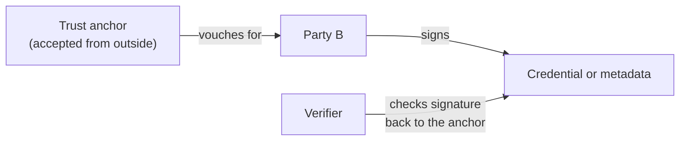
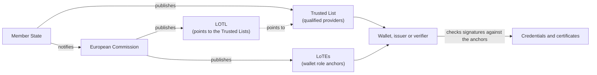
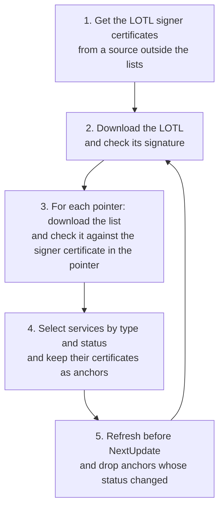
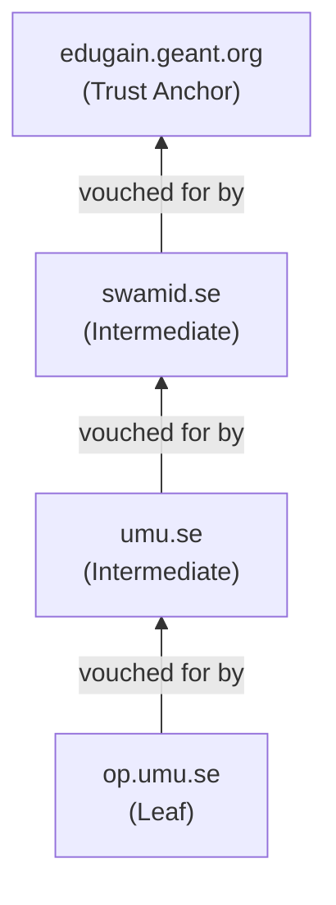
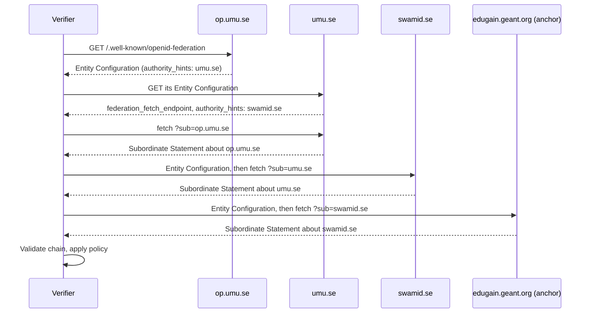
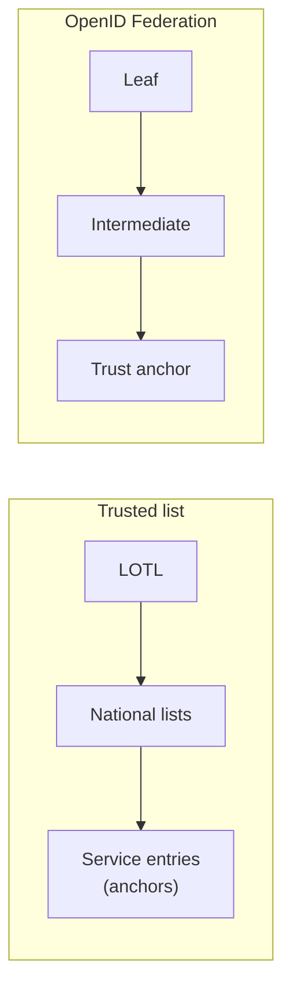

# Trusted lists and OpenID Federation: a crash course

Two ways to answer one question: *should I believe this party?* Written to be read at home after the session.

**Who this is for:** technical colleagues who know signatures, X.509 and JWTs, but are new to ETSI trusted lists or OpenID Federation.
**What it gives you:** how each mechanism works, how they differ, and commands to try both on real data.
**What it does not give you:** the full specifications, or legal advice.

How to read it: sections 1 and 2 set the scene. Part 1 (sections 3 to 7) is trusted lists. Part 2 (sections 8 to 13) is OpenID Federation. Part 3 (sections 14 to 16) compares them. Section 17 is practical. Appendices A and B are hands-on. Appendix C is a worked chain. Appendix D lists the sources.

> **Status of statements.** Figures about the EU and Swedish lists were read live from the published files on 19 November 2026. Statements about OpenID Federation come from the final 1.0 specification of 17 February 2026. Statements about the EU wallet come from the ARF, chapter 6 and annex 2.02, as read on the same day. Statements about our code come from reading the SUNET/vc documentation in November 2026. **Not read:** the ETSI TS 119 612 and TS 119 602 documents themselves. Where this handout describes their detail, it comes from the live files and the ARF, and is marked *check*.

---

## 1. The problem

A verifier receives a signed thing: a credential, a certificate, a piece of metadata. The signature checks out. That proves that *some key* signed it. It does not prove that the owner of that key is someone the verifier should believe.

So every system needs a **trust anchor**: something the verifier accepts without further proof, and from which everything else is checked.



The two mechanisms in this course differ in how the verifier gets from the anchor to party B:

- A **trusted list** puts the answer in one signed document that the verifier downloads.
- **OpenID Federation** puts the answer in a chain of signed statements that the verifier collects.

---

## 2. Words you will meet

| Word | Plain meaning |
|---|---|
| **Trust anchor** | The key or certificate you accept from outside. Everything else is checked back to it. |
| **Trusted List (TL)** | A signed list of trust service providers and their services, one per EU Member State. Format from ETSI TS 119 612. |
| **LOTL** | List Of Trusted Lists. A TL published by the European Commission that points to every national TL. |
| **LoTE** | List of Trusted Entities. ETSI TS 119 602. Commission-published lists of trust anchors for wallet roles. |
| **TSP** | Trust Service Provider. A party that offers trust services, for example issuing qualified certificates. |
| **QTSP** | A *qualified* TSP. It has qualified status on a Trusted List. |
| **QEAA** | Qualified Electronic Attestation of Attributes. Issued by a QTSP. |
| **PuB-EAA** | An attestation issued by or for a public sector body, from an authentic source. |
| **Entity (federation)** | Any participant: a service, a university, a federation operator. Identified by an `https` URL. |
| **Entity Configuration** | The signed statement an entity makes about itself. |
| **Subordinate Statement** | The signed statement an authority makes about an entity below it. |
| **Trust chain** | The sequence of statements from an entity up to a trust anchor. |
| **Trust mark** | A signed badge: this entity meets a named requirement. |
| **Metadata policy** | Rules from above about what entities below may claim. |

A word of warning: in the SUNET/vc repository, "TSL" means *Token Status List*, a revocation list. A *Trusted List* is a different thing.

---

# Part 1. Trusted lists

## 3. Three kinds of list

| List | Published by | Holds | Based on |
|---|---|---|---|
| **Trusted List** | Each Member State | Trust service providers and their services. In the wallet world: anchors of QEAA providers. | ETSI TS 119 612 |
| **LOTL** | The European Commission | Pointers to every national Trusted List, with the certificates that sign them | ETSI TS 119 612 |
| **LoTE** | The European Commission | Trust anchors of PID Providers, PuB-EAA Providers, Wallet Providers, Access Certificate Authorities and Providers of registration certificates | ETSI TS 119 602 |

The LOTL does not list providers. It lists the other lists. Do not confuse it with a LoTE.

**Format.** The Trusted Lists and the LOTL read for this handout are XML documents with an XAdES signature (section 4). LoTEs are different: ETSI TS 119 602 defines a JSON schema, and the EUDI reference library has a module that reads and writes LoTEs as JSON. *Check:* I did not read TS 119 602, so I do not know whether it also allows an XML form, or how the JSON form is signed. The ARF only says the Commission signs or seals the LoTEs.



### Which party goes on which list

This table is from the ARF, section 6.3.2.4, and annex 2.02 topics 1, 10 and 31.

| Party | Where its trust anchors go |
|---|---|
| Wallet Provider | Wallet Provider LoTE, after the Member State notifies the Commission |
| PID Provider | PID Provider LoTE, after notification |
| PuB-EAA Provider | PuB-EAA Provider LoTE, after notification |
| QEAA Provider | A Trusted List, once it has qualified status |
| Non-qualified EAA Provider | No list. The attestation's rulebook says how a verifier finds the anchor. The ARF notes that a LoTE is one option. |
| Access Certificate Authority | A LoTE |
| Provider of registration certificates | A LoTE |

The ARF requires wallets, issuers and relying parties to support both Trusted Lists (TS 119 612) and LoTEs (TS 119 602), and to refresh them regularly (OIA_15a, OIA_15b, ISSU_10a).

---

## 4. Walk the real lists

Read on 19 November 2026.

**The EU LOTL**, `https://ec.europa.eu/tools/lotl/eu-lotl.xml`:

| Field | Value |
|---|---|
| Type | `EUlistofthelists` |
| Operator | European Commission |
| Sequence number | 398 |
| Issued | 2026-11-09 |
| Next update | 2027-05-02 |
| Pointers | 43 (32 to XML lists, 11 to PDF copies for people) |
| Signature method | RSA with SHA-512, exclusive canonicalization, XAdES |

Each pointer holds the location of a list, the certificates that sign it, the operator's name and a reference to the scheme rules. Sweden's pointer leads to `https://trustedlist.pts.se/tlv6/SE-TL.xml`.

**The Swedish list**, operated by the Swedish Post and Telecom Agency (PTS):

| Field | Value |
|---|---|
| Type | `EUgeneric` |
| Sequence number | 63 |
| Issued | 2026-10-07 |
| Next update | 2027-04-07 |
| Providers | 5: SignGuard Europe AB, TrustWeaver AB, ZealiD AB, IDnow Trust Services AB, Fourthline Trust Services AB |
| Current services | 20 |
| Status of current services | 16 granted, 4 withdrawn |
| History entries | 6 (earlier statuses such as `undersupervision`) |

The 20 current services have these types: `CA/QC` (6), `QESValidation/Q` (3), `RemoteQSigCDManagement/Q` (3), `Certstatus/OCSP/QC` (2), `TSA/QTST` (2), and one each of `RemoteQSealCDManagement/Q`, `ElectronicArchiving/Q`, `PSES/Q` and `EAA/Q`. The last one shows that the wallet era is already in the format.

---

## 5. Inside a Trusted List

```
TrustServiceStatusList
  SchemeInformation
    TSLType, TSLSequenceNumber
    ListIssueDateTime, NextUpdate
    SchemeOperatorName, legal notices
    PointersToOtherTSL          (LOTL only)
  TrustServiceProviderList
    TrustServiceProvider
      TSPInformation
      TSPServices
        TSPService
          ServiceInformation    (type, name, status, digital identity)
          ServiceHistory        (earlier statuses)
  Signature                     (XAdES)
```

*Check against TS 119 612.* The tree comes from the live files.

What a verifier cares about in an entry:

- **Service type.** A URI per kind of service, for example `.../Svctype/CA/QC` for a qualified certificate authority and `.../Svctype/EAA/Q` for a qualified attestation service.
- **Status.** The current status of a service in the Swedish list is `granted` or `withdrawn`. `ServiceHistory` keeps earlier statuses, for example `undersupervision`.
- **Digital identity.** Usually an X.509 certificate. This is the trust anchor.

Two numbers keep the list honest: `TSLSequenceNumber` rises with every issue, and `NextUpdate` says when the next one is due.

---

## 6. How a verifier uses the lists



1. **One anchor from outside.** The LOTL's scheme information points to a notice in the Official Journal. The ARF (TLPub_07) says the Commission publishes there the anchors for its LoTE signature. *Check where the LOTL signer certificates are published.*
2. **Check, then trust.** Verify the XML signature before reading any pointer.
3. **Anchors by role.** The ARF requires a verifier to keep anchors sorted by credential type: PID, QEAA, PuB-EAA, non-qualified EAA. A QEAA must be checked against a Trusted List anchor.
4. **Keep fresh.** Remove anchors when an entry is invalidated or a certificate expires or is revoked (OIA_15a).

---

## 7. Trusted lists in our code

Trust decisions in SUNET/vc go to a separate trust service, built on SUNET's go-trust. It answers: is this key trusted for this role? The configuration documentation names trust frameworks per role, with example values `etsi-tl`, `x509`, `did:web` and `openid-federation`. The repository's ARF gap analysis marks trusted list and LoTE lookup as covered.

SUNET/vc also has a command-line tool, `lol`, that fetches a List of Trusted Lists, checks every list it points to for reachability and expiry, and verifies signatures against trust anchors you give it. It is described in appendix A.

Questions worth asking: "Which lists do we load, and how often?" "Who holds the LOTL signer certificates, and how do we update them?" "What does the verifier do when a list is past `NextUpdate`?"

---

# Part 2. OpenID Federation

## 8. The idea

The same problem: a verifier meets a party it has never met. OpenID Federation 1.0 solves it without a central list.

- Every entity publishes a signed statement about itself at `/.well-known/openid-federation` under its entity identifier.
- That statement names the authorities above it in `authority_hints`.
- Authorities publish signed statements about the entities below them at a **fetch endpoint**.
- The verifier follows the hints upward and collects statements until it reaches an anchor it already trusts.

The specification's own example uses our world: the OpenID Provider `op.umu.se`, vouched for by `umu.se`, vouched for by `swamid.se`, vouched for by `edugain.geant.org`.



The specification says it concerns itself with how entities get to know each other. It does not cover protocol operations beyond metadata. An entity may belong to more than one federation. An organisation may be more than one entity.

The mechanism does not use web PKI for signatures. Keys are JWKs, carried in the statements themselves. This follows research and education federations, which have worked this way for over a decade.

---

## 9. Two kinds of statement

Both are signed JWTs. The header `typ` must be `entity-statement+jwt`, the `alg` must not be `none`, and the `kid` must match a key in the issuer's `jwks`.

| Aspect | Entity Configuration | Subordinate Statement |
|---|---|---|
| Who signs | The entity, about itself | An authority, about an entity below it |
| `iss` and `sub` | Equal | Different. `iss` is the authority. |
| Found at | `<entity id>/.well-known/openid-federation` | The authority's `federation_fetch_endpoint`, with `?sub=<entity id>` |
| Typical claims | `jwks`, `metadata`, `authority_hints`, `trust_marks` | `jwks`, `metadata`, `metadata_policy`, `constraints`, `source_endpoint` |
| Content type | `application/entity-statement+jwt` | `application/entity-statement+jwt` |

Claims every statement has: `iss`, `sub`, `iat`, `exp`, `jwks`.

Entity types are named in `metadata`. The federation's own endpoints live under `federation_entity`. Protocol roles use identifiers such as `openid_provider`, `openid_relying_party`, `oauth_client` or `oauth_authorization_server`. Intermediates and trust anchors must publish a fetch endpoint and a list endpoint. A leaf must not.

---

## 10. The trust chain

A chain starts with the Entity Configuration of the subject and ends with the Entity Configuration of the trust anchor. In between are Subordinate Statements.

For `op.umu.se` and the anchor `edugain.geant.org`, the specification's example gives this chain:

1. Entity Configuration of `op.umu.se`
2. Subordinate Statement by `umu.se` about `op.umu.se`
3. Subordinate Statement by `swamid.se` about `umu.se`
4. Subordinate Statement by `edugain.geant.org` about `swamid.se`
5. Entity Configuration of the anchor (may be omitted from the array)



### Validation, in short

For each statement `ES[j]` in the chain:

- All required claims are present. `iat` is in the past. `exp` is in the future.
- `ES[0]` has `iss` = `sub` and is signed with a key in its own `jwks`.
- For every link, `ES[j].iss` equals `ES[j+1].sub`, and `ES[j]` is signed with a key in `ES[j+1].jwks`.
- The last statement is the trust anchor's own, checked against the anchor keys you hold from outside.

Then apply metadata policy and constraints (sections 11). The chain's lifetime is the smallest `exp` in it.

Loops are forbidden. An implementation should limit how many `authority_hints` it follows. The specification warns that fake hints can be used to make a verifier send many requests.

### Three ways to use it

- **Bottom-up resolution.** Start from a known entity id and build the chain. Used when you must check one party.
- **Top-down discovery.** Start from an anchor and use list endpoints to find members. Used for directories.
- **Resolver.** Ask a trusted resolver endpoint to do the work and return resolved metadata and the chain. You then trust the resolver to check correctly.

---

## 11. Rules that flow downward

### Metadata policy

A Subordinate Statement may carry `metadata_policy`. It applies to the subject and to everyone below it. Standard operators:

| Operator | Action |
|---|---|
| `value` | Force the value. `null` removes the parameter. |
| `add` | Add values to an array |
| `default` | Set a value if absent |
| `one_of` | The value must be one of these |
| `subset_of` | Reduce an array to the intersection |
| `superset_of` | The array must contain these |
| `essential` | The parameter must be present |

Policies from all authorities in a chain are merged from the top down. Nobody below can loosen a policy. A conflict makes the chain invalid. A federation can define extra operators and mark them critical with `metadata_policy_crit`.

Example from the specification, shortened:

```json
"metadata_policy": {
  "openid_relying_party": {
    "grant_types": { "subset_of": ["authorization_code"] },
    "contacts":    { "add": ["helpdesk@org.example.org"] }
  }
}
```

A plain `metadata` claim in a Subordinate Statement is applied first, to the subject only. Policy is then applied to the result. The outcome is the **resolved metadata**.

### Constraints

| Constraint | Limits |
|---|---|
| `max_path_length` | How many intermediates may lie between the authority and the subject |
| `naming_constraints` | Which entity identifiers are permitted or excluded, written like X.509 name constraints |
| `allowed_entity_types` | Which entity types the subordinates may have |

---

## 12. Trust marks

A trust mark is a signed JWT (`typ` `trust-mark+jwt`) that says: this entity meets a named requirement. It has an issuer, a subject, a `trust_mark_type` and optionally `exp`, `ref` and a `delegation`.

- The trust anchor lists accepted issuers per type in `trust_mark_issuers`. An empty list means anyone may issue that type.
- A trust mark owner may delegate issuing rights with a signed delegation JWT.
- To validate: first establish trust in the issuer through its own chain. Then check the mark's signature and lifetime.
- Without `exp`, use the issuer's status endpoint. It answers `active`, `expired`, `revoked` or `invalid`.

The specification's example: `swamid.se` issues the REFEDS Sirtfi trust mark to `https://umu.se/op`.

---

## 13. Federation in our code

SUNET/vc already has support for OpenID Federation. The verifier and apigw can publish an Entity Configuration, and the trust service has an `openid-federation` framework next to `etsi-tl`.

Questions worth asking: "Which federation and which anchor would we trust?" "Who runs the anchor and the intermediates?" "Do we want trust marks, and who issues them?"

---

# Part 3. Compare

## 14. The shape of each

| Aspect | Trusted list | OpenID Federation |
|---|---|---|
| Shape | One flat signed document, plus an index of such documents | A tree of signed statements |
| Unit of signing | The whole list | Each statement |
| Format | Trusted Lists and the LOTL: XML with XAdES. LoTEs: a JSON data model (see section 3). | JWT, JWS, keys as JWK |
| Anchor held by the verifier | Signer certificates of the LOTL | Entity id and keys of the trust anchor |
| Start point for a check | The LOTL | The entity id of the party to check |
| Direction | Top-down: download everything, keep what you need | Bottom-up: build a chain for one entity |
| Offline use | From cache, until `NextUpdate` | From a cached chain, until the earliest `exp` |



---

## 15. Aspect by aspect

### Who decides and what it means

| Aspect | Trusted list | OpenID Federation |
|---|---|---|
| Publisher | Member States. The Commission for the LOTL and LoTEs. | The federation operator, intermediates, and each entity about itself |
| Getting in | Notification and supervision lead to an entry with a status | A Subordinate Statement from your immediate superior |
| Legal weight | High. Qualified status under eIDAS comes from the list. The ARF requires a QEAA to be checked against a Trusted List. | None by itself. Each federation defines what membership means. |
| Accountability | Supervisory bodies and national law | The federation's own policy |

### Freshness and failure

| Aspect | Trusted list | OpenID Federation |
|---|---|---|
| Update signal | `TSLSequenceNumber`, `NextUpdate` | `exp` on every statement |
| Removal | Status changes. Verifiers must download again. | The specification defines no revocation process. Statements expire or are no longer issued. A federation may add its own. |
| Key change | New certificate in the entry | New keys in `jwks`. Optional historical keys endpoint. |
| Quiet failure | A stale list kept in use after `NextUpdate` | A cached chain kept in use after `exp` |
| Loud failure | Signature does not check | Endpoint unreachable. Chain does not validate. |
| Attack surface | Compromise of a list signer | Many fake `authority_hints` can cause many requests |

### What can be said

| Aspect | Trusted list | OpenID Federation |
|---|---|---|
| Content | Provider, service type, status, certificate | Metadata, keys, trust marks, policy, constraints |
| Rules about members | Outside the list: schemes and supervision | Inside the statements, merged down the chain |
| Roles | By service type | By entity type. One entity may have several. |
| Several authorities | One list per scheme | One entity may belong to several federations |

### Reach and the EU wallet

| Aspect | Trusted list | OpenID Federation |
|---|---|---|
| Reach | EU-wide. 43 pointers in the LOTL on 19 November 2026. | Per federation. eduGAIN connects national federations such as SWAMID. |
| In the EU wallet trust model | Central. Trusted Lists and LoTEs. | Not part of the ARF trust model as read on 19 November 2026 |
| Our fit | Needed to accept EU credentials and qualified providers | Fits the sector trust we already run in SWAMID |

---

## 16. When to use which

A rule of thumb, not a law.

| A list fits when | A federation fits when |
|---|---|
| Legal status matters | Many entities join and leave |
| Parties are few and change slowly | You need rules on what members may claim |
| Verifiers must run from cache | Registration is delegated down a hierarchy, as in universities |
| The EU wallet model requires it | You want badges for compliance |

They can live in one verifier. The trust service chooses a framework per role: qualified providers by list, sector services by federation. An authority may also serve both: a national body could publish a list and run a federation anchor.

**One honest limit.** Both mechanisms tell you who may be trusted. Neither tells you whether a party is *trustworthy* in the wider sense. The OpenID Federation specification says so itself.

---

## 17. Working with this topic

### Questions that show you understand

- "What is the trust anchor here, and who decided that?"
- "How does a removed party stop being trusted, and how fast?"
- "What happens when our cache is older than `NextUpdate` or `exp`?"
- "Is that a qualified provider, a PID Provider, or something outside the lists?"
- "Which federation, and who runs the anchor?"

### Red flags

- A list that is used without checking its signature.
- A list or chain used past its expiry.
- "It is on the list" with no word on which list, or which service type.
- Fetching federation statements with no limit on hints or depth.
- A trust mark accepted without checking its issuer.

### Where the real risk sits

1. **Governance.** Who notifies, who supervises, who runs the anchor, who pays.
2. **Operations.** Refreshing lists and chains on time, and updating anchors.
3. **Moving standards.** LoTE rules and OpenID Federation 1.1 are still new. Check status before you commit.
4. **Interoperability.** Two correct implementations can still disagree on details.

---

# Appendices

## Appendix A. Check lists with `lol`

`lol` is a diagnostic command-line tool in SUNET/vc, released as [lol-v0.1.0](https://github.com/SUNET/vc/releases/tag/lol-v0.1.0) with binaries for Linux, macOS and Windows and a `checksums-sha256.txt`. It fetches a List of Trusted Lists (LoTL), then every list the LoTL points to, and reports for each list:

- whether it is reachable,
- what kind of list it is,
- when it expires (`NextUpdate`),
- and, if you give it trust anchors, whether its signature verifies.

The signature check uses go-trust's own verifier, so `lol` and the trust service agree on what counts as valid.

```bash
lol                                        # expiry and kind of every list, signatures not checked
lol -anchors anchors.pem                   # also verify signatures against your anchors
lol -v                                     # kind, operator, type, format and URL per list
lol -json | jq '.lists[] | select(.state != "ok")'
lol -lotl https://example.org/lotl.json    # another LoTL
```

Two more uses:

- `lol -anchors lotl-signer.pem -export-anchors bundle.pem` writes a `trust_anchor_bundle` for go-trust. A list goes into the bundle only if it verifies with the certificate its LoTL pointer names. A list that cannot be backed is left out and the exit code is 1.
- `-show_fingerprint` prints the SHA-256 fingerprint of each signer certificate, so you can compare it with one from the publisher.

The pinned LoTL signer certificate must come from outside, not from the LoTL's own signature header. The header only shows that the file is consistent with itself, not who published it.

Exit codes: 0 means every list is current and, with `-anchors`, verified. 1 means a list is stale or failed, or the LoTL signature failed. 2 means a usage, fetch or parse error.

---

## Appendix B. Try OpenID Federation

You need `curl`, `python3` and `jq`. Replace `ENTITY` with a real entity identifier from a federation you can reach. This handout does not list one, because live federations change. Ask a colleague, or look at the federation your partners run.

Fetch an Entity Configuration and read it:

```bash
ENTITY=https://entity.example        # replace
curl -fsSL "${ENTITY%/}/.well-known/openid-federation" -o ec.jwt

# Decode header and payload (no signature check)
python3 - <<'EOF'
import base64, json
def b64(s): return base64.urlsafe_b64decode(s + '=' * (-len(s) % 4))
h, p, _ = open('ec.jwt').read().strip().split('.')
print(json.dumps(json.loads(b64(h)), indent=2))
payload = json.loads(b64(p))
print(json.dumps({k: payload[k] for k in payload
                  if k in ('iss','sub','iat','exp','authority_hints')}, indent=2))
print('entity types:', list(payload.get('metadata', {})))
EOF
```

Check three things in the output: the header `typ` is `entity-statement+jwt`, `iss` equals `sub`, and `authority_hints` names the authority above.

Fetch the Subordinate Statement from an authority. First read its `federation_fetch_endpoint` from its own Entity Configuration:

```bash
AUTH=https://authority.example       # a value from authority_hints
curl -fsSL "${AUTH%/}/.well-known/openid-federation" -o auth.jwt
FETCH=$(python3 - <<'EOF'
import base64, json
def b64(s): return base64.urlsafe_b64decode(s + '=' * (-len(s) % 4))
p = open('auth.jwt').read().strip().split('.')[1]
print(json.loads(b64(p))['metadata']['federation_entity']['federation_fetch_endpoint'])
EOF
)
curl -fsSL --get --data-urlencode "sub=$ENTITY" "$FETCH" -o sub.jwt
```

This handout did not run this appendix against a live federation. The commands follow sections 3, 8 and 9 of the specification. *Check against a real entity before you teach it.*

---

## Appendix C. A worked chain

From the specification's appendix A, shortened. A relying party wants to know the metadata of `https://op.umu.se`. It trusts `https://edugain.geant.org`.

1. **Entity Configuration of `op.umu.se`.** `authority_hints` is `["https://umu.se"]`. The metadata type is `openid_provider`.
2. **Entity Configuration of `umu.se`.** The only piece used is `federation_fetch_endpoint`. Its `authority_hints` is `["https://swamid.se"]`.
3. **Subordinate Statement by `umu.se` about `op.umu.se`.** It carries a metadata policy: add `ops@swamid.se` to `contacts`, force `subject_types_supported` to `pairwise`, and limit `token_endpoint_auth_methods_supported`.
4. **Entity Configuration of `swamid.se`.** Its `authority_hints` is `["https://edugain.geant.org"]`.
5. **Subordinate Statement by `swamid.se` about `umu.se`.** A policy that limits signing algorithms.
6. **Entity Configuration of `edugain.geant.org`.** The anchor. The verifier already holds its keys from outside.
7. **Subordinate Statement by `edugain.geant.org` about `swamid.se`.** A policy that adds `ops@edugain.geant.org` to contacts.

The verifier validates the signatures link by link, then merges the three policies from the top down. The result is the resolved metadata of `op.umu.se`: contacts from all authorities added, subject types limited to `pairwise`, and an allowed set of authentication methods.

Intermediates' Entity Configurations are used to find fetch endpoints. They are not part of the trust chain array.

---

## Appendix D. Sources

**Trusted lists and the wallet**
- ETSI TS 119 612 (Trusted Lists) and ETSI TS 119 602 (Lists of Trusted Entities). **Not read for this handout.** Referenced by the ARF.
- EU Digital Identity Wallet Architecture and Reference Framework, `eudi.dev`: [chapter 6, trust model](https://eudi.dev/latest/main/06-trust-model/) (sections 6.2 to 6.6), and [annex 2.02](https://eudi.dev/latest/annexes/annex-2/annex-2.02-high-level-requirements-by-topic/): topics 1, 10, 31 and requirements OIA_12 to OIA_15b, ISSU_10a, ISSU_10b, TLPub_01 to TLPub_08.
- The EU LOTL: `https://ec.europa.eu/tools/lotl/eu-lotl.xml`. The Swedish list: `https://trustedlist.pts.se/tlv6/SE-TL.xml`. Both read on 19 November 2026.

**OpenID Federation**
- [OpenID Federation 1.0](https://openid.net/specs/openid-federation-1_0.html), final, 17 February 2026. Sections 2 to 4, 6 to 10, 11.4, 17, 18 and appendix A.
- OpenID Federation 1.1 and OpenID Federation for OpenID Connect 1.1 split the same content into a protocol-independent and a protocol-specific part. The specification says either can be used interchangeably.

**Our code: [SUNET/vc](https://github.com/SUNET/vc)**
- `docs/TRUST_AND_IDENTITY.md`, `docs/CONFIGURATION.md` and `docs/ARF_3_0_GAP_ANALYSIS.md`.
- [lol-v0.1.0](https://github.com/SUNET/vc/releases/tag/lol-v0.1.0): the `lol` tool, and its README at `developer_tools/scripts/lol/README.md`. Not run for this handout.

**Related course**
- [Digital identity for universities: a crash course](../digital-identity-crash-course/handout.md). Sections 9 and 10 are the short versions of Parts 1 and 2 here.
